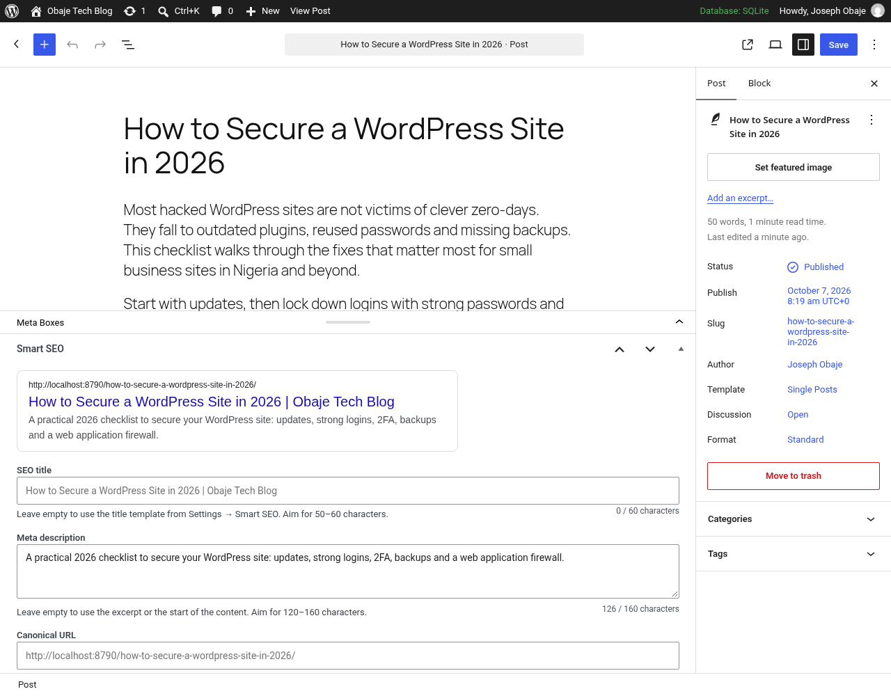
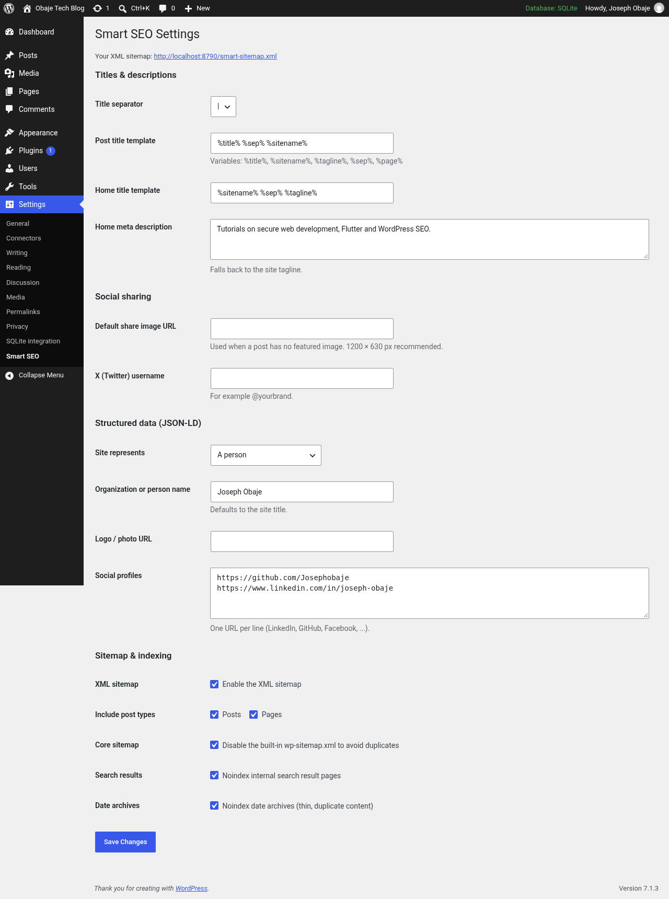

# WP Smart SEO


A lightweight, dependency-free WordPress SEO plugin that covers the essentials without the bloat:
custom meta titles and descriptions per post, Open Graph and Twitter Card tags, JSON-LD structured
data, an XML sitemap and canonical URLs, all configured from one settings page.

It is written to WordPress Coding Standards (WPCS), escapes all output, sanitises all input,
verifies nonces and capabilities, and is fully translatable.



## Features

- **Per-post SEO meta box** (posts, pages and public custom post types), with:
  - custom SEO title, meta description, canonical URL and a "noindex" switch
  - a live Google-style search result preview
  - character counters (60 for titles, 160 for descriptions)
- **Title templates** using the variables `%title%`, `%sitename%`, `%tagline%`, `%sep%` and `%page%`, with a configurable separator. Separators left dangling by empty variables are cleaned up automatically.
- **Meta descriptions**, chosen in this order: custom field, then the excerpt, then the first 160 characters of the content (cut at a word boundary).
  - The home page has its own description, falling back to the tagline.
- **Canonical URLs** for singular content, with pagination support and custom overrides. They replace the core `rel=canonical` output so there are no duplicates.
- **Open Graph and Twitter Card tags**: `og:title`, `og:description`, `og:url`, `og:image`, `og:type`, `article:published_time` and more.
  - The featured image is used as the share image, with a site-wide default as fallback.
- **JSON-LD structured data** as a single `@graph`:
  - `Organization` or `Person` (name, logo and `sameAs` profiles)
  - `WebSite` with a `SearchAction`
  - `BlogPosting` for posts (author, dates, section, keywords and image)
- **XML sitemap** at `/smart-sitemap.xml`:
  - a sitemap index plus paginated child sitemaps per post type, with `lastmod`
  - excludes posts set to noindex and posts canonicalised to another URL
  - added to `robots.txt` automatically
  - can disable the core `wp-sitemap.xml` to avoid duplicates
- **Robots control** through the core `wp_robots` API:
  - noindex for individual posts, search results and date archives
  - `max-image-preview:large` for indexable content
- **Admin settings page** at *Settings → Smart SEO*, built on the Settings API.
- **Security**:
  - nonces on save
  - capability checks (`edit_post`, `manage_options`)
  - autosave and revision guards
  - strict sanitisation of every field
  - context-aware escaping (`esc_attr`, `esc_url`, `esc_html`, XML escaping)
  - JSON-LD encoded with `JSON_HEX_TAG` so `</script>` cannot break out
- **i18n**: every string uses the `wp-smart-seo` text domain, and a `.pot` template ships in `languages/`.
- **Clean uninstall** removes the plugin option and all of the plugin's post meta.

## Screenshots

| Settings → Smart SEO | Meta box with SERP preview |
| --- | --- |
|  |  |

Example front-end output captured from a live WordPress 7.1 install is in
[`docs/examples/`](docs/examples):
- [`head-output.html`](docs/examples/head-output.html): meta, Open Graph, Twitter and JSON-LD tags
- [`smart-sitemap.xml`](docs/examples/smart-sitemap.xml) and [`smart-sitemap-post-1.xml`](docs/examples/smart-sitemap-post-1.xml)

```html
<!-- WP Smart SEO -->
<meta name="description" content="A practical 2026 checklist to secure your WordPress site: ..." />
<link rel="canonical" href="https://example.com/how-to-secure-a-wordpress-site-in-2026/" />
<meta property="og:type" content="article" />
<meta property="og:title" content="How to Secure a WordPress Site in 2026 | Obaje Tech Blog" />
<meta name="twitter:card" content="summary" />
<script type="application/ld+json">{"@context":"https://schema.org","@graph":[ ... ]}</script>
<!-- / WP Smart SEO -->
```

## Tech stack

- PHP 7.4+ (runtime), WordPress 6.0+
- WordPress APIs: Settings, Metadata (`register_post_meta`), Rewrite, `wp_robots`, `document_title`, i18n
- Dev tooling (PHP 8.2+):
  - PHPUnit 11
  - Brain Monkey and Mockery, to unit-test WordPress code without loading WordPress
  - PHP_CodeSniffer with WordPress Coding Standards 3 and PHPCompatibilityWP

## Project structure

```
wp-smart-seo/
├── wp-smart-seo.php            # Plugin bootstrap (header, constants, hooks)
├── uninstall.php               # Removes options and post meta on uninstall
├── includes/
│   ├── class-plugin.php        # Wiring, text domain, admin assets, activation
│   ├── class-settings.php      # Option defaults + sanitisation
│   ├── class-settings-page.php # Settings → Smart SEO (Settings API)
│   ├── class-post-meta.php     # Registered post meta + sanitisers
│   ├── class-meta-box.php      # Editor meta box, nonce + capability checks
│   ├── class-meta-resolver.php # Titles, descriptions, canonicals, robots, social tags
│   ├── class-schema.php        # JSON-LD graph builder
│   ├── class-sitemap.php       # XML sitemap index + child sitemaps, robots.txt
│   ├── class-head-output.php   # Front-end <head> output
│   └── class-text.php          # Text clean-up and word-safe truncation
├── assets/                     # Admin CSS + JS (counters, live preview)
├── languages/wp-smart-seo.pot  # Translation template
├── tests/Unit/                 # PHPUnit + Brain Monkey tests
├── docs/                       # Screenshots and example output
├── phpcs.xml.dist              # WPCS ruleset
└── phpunit.xml.dist
```

## Getting started

### Install in WordPress

1. Download or clone this repository into `wp-content/plugins/wp-smart-seo`:
   ```bash
   cd wp-content/plugins
   git clone https://github.com/Josephobaje/wp-smart-seo.git
   ```
2. Activate **WP Smart SEO** under *Plugins*.
3. Open *Settings → Smart SEO* to set your title templates, social profiles and sitemap options.
4. If the sitemap returns a 404, re-save *Settings → Permalinks*. Activation flushes rewrite rules, so this is rarely needed.

### Usage

- **Per post:** edit any post or page and scroll to the **Smart SEO** box.
  - Leave fields empty to use the automatic defaults.
  - The preview updates as you type.
- **Sitemap:** submit `https://your-site.com/smart-sitemap.xml` in Google Search Console and Bing Webmaster Tools.
- **Developers:** meta values are registered with `show_in_rest`, so you can read and write them through the REST API.
  - The keys are `_wpss_title`, `_wpss_description`, `_wpss_canonical` and `_wpss_noindex`.
  - Writing requires the `edit_post` capability.

## Development

```bash
composer install
composer lint      # PHPCS with WordPress-Extra, WordPress-Docs and PHPCompatibilityWP
composer lint:fix  # auto-fix with PHPCBF
composer test      # PHPUnit + Brain Monkey
```

Current results:

- `composer lint`: no errors or warnings against WordPress-Extra, WordPress-Docs and PHPCompatibilityWP (PHP 7.4+).
- `composer test`: **70 tests, 189 assertions, all passing**. Areas covered:
  - text truncation
  - settings sanitisation
  - title templates and separators
  - description fallbacks
  - canonical and pagination
  - noindex rules
  - social tags
  - JSON-LD graph and `</script>` safety
  - sitemap XML escaping and exclusions
  - meta sanitisers
  - meta box nonce, capability and autosave guards
  - head output escaping

Regenerate the translation template with:

```bash
xgettext --language=PHP --from-code=UTF-8 --keyword=__ --keyword=_e --keyword=esc_html__ \
  --keyword=esc_html_e --keyword=esc_attr__ --keyword=esc_attr_e --keyword=_x:1,2c \
  --add-comments=translators -o languages/wp-smart-seo.pot wp-smart-seo.php includes/*.php
```

## Roadmap

- [ ] Taxonomy and author archive titles and descriptions
- [ ] Image sitemap entries
- [ ] Breadcrumb schema and a breadcrumb block
- [ ] Per-post social image override
- [ ] Integration tests with the WordPress test suite (`wp-env`)
- [ ] Gutenberg sidebar panel as an alternative to the classic meta box

## License

Released under the [MIT License](LICENSE). © 2026 Joseph Obaje.

## Author

**Joseph Obaje**: Full Stack Developer (Flutter · PHP · Python · WordPress · Cybersecurity · SEO)

- GitHub: [@Josephobaje](https://github.com/Josephobaje)
- LinkedIn: [joseph-obaje](https://www.linkedin.com/in/joseph-obaje)
